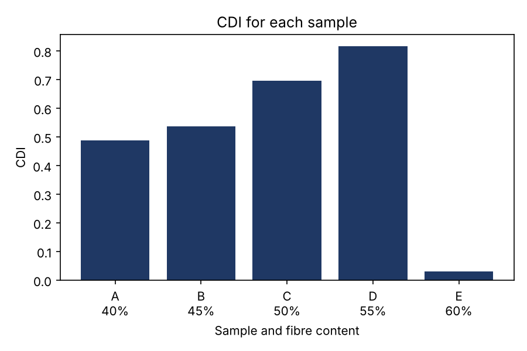

# Thesis composite analysis

This is the data analysis from my final-year project at the Air Force Institute of Technology (AFIT), Kaduna, redone in Python.

The project: *Production of Bio-based Packaging Material from Luffa cylindrica Fiber Using Sweet Potato Peel Starch and Gum Arabic as Binders* (July 2026).

## The project in short

I made five packaging composites (Samples A to E) from Luffa fibre, with fibre content going from 40% to 60%. Sweet potato peel starch and gum Arabic held the fibre together. The samples were tested for compression, tensile strength, flexural strength and hardness at the DICON R&D unit in Kaduna.

## What the script does

It takes the test results in `data.csv`, scales each result between 0 and 1, and averages the four into one score for each sample. I call that score the Composite Desirability Index (CDI), following the idea from Derringer and Suich (1980). The script also fits a quadratic curve to each result against fibre content and draws a bar chart of the CDI.

## Results

| Sample | Fibre (%) | Binder-to-fibre ratio | CDI |
|--------|-----------|-----------------------|-------|
| A | 40 | 1.50 | 0.487 |
| B | 45 | 1.22 | 0.537 |
| C | 50 | 1.00 | 0.696 |
| D | 55 | 0.82 | 0.816 |
| E | 60 | 0.67 | 0.031 |

Sample D, with 55% fibre, came out best. It had the highest compression force, tensile strength and flexural strength. Sample E, with 60% fibre, scored lowest. In my thesis I put that down to not having enough binder for that much fibre.



## Running it

Put the files in one folder and run:

```
pip install numpy pandas matplotlib
python analysis.py
```

## Things to keep in mind

I had only one sample for each formulation and no repeats, so the curves just describe the five samples I tested. They are not proven predictions.
